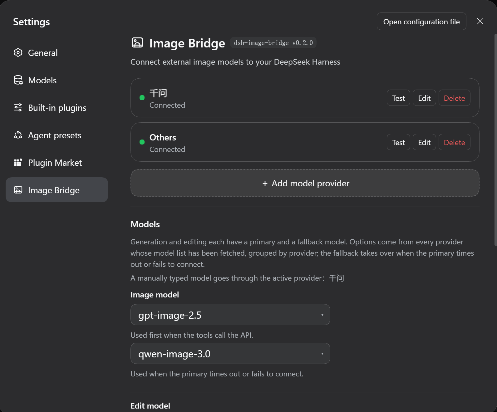

<p align="center">
  
</p>

# Image Bridge (dsh-image-bridge)

English | [中文](README.md)

[](https://github.com/kkj520/dsh-image-bridge)
[](https://github.com/deepseek-ai)

Give a [DeepSeek Harness](https://github.com/deepseek-ai) model that **cannot draw** access to an external image service: install one plugin and the model gains two tools — `image_generate` and `image_edit` — with each result shown in the conversation as a persistent image attachment and saved to `generated-images/` in the session workspace.



## Install

Requires a local `@deepseek-ai/dsh` (a working `dsh web`). If you do not have one:

```sh
npm i -g @deepseek-ai/dsh
```

Install the plugin, using the absolute path to this repo:

```sh
dsh plugin --profile web add <absolute path to this repo>/plugins/dsh-image-bridge-v4
```

Your agent can also install it through the plugin manager: `install_bundle` with that directory as the target.

- Package name `@local/dsh-image-bridge`, version **0.2.0**. The `@local/` prefix is the DSH convention for locally authored plugins; it is not published to npm.
- Installation adds the plugin row to the profile config layer (row id `image-bridge-v4`, which is also the namespace the settings page writes to).
- **Restart `dsh web` afterwards** — plugin code is not hot-reloaded, and the settings page will not appear before the restart.

**Confirm it loaded** — any one of the three:

- **Settings → Image Bridge** shows the settings page;
- `$DSH_HOME/dsh-image-bridge-startup.json` lists three `steps` (schema ready, both tools registered, test channel mounted) and `services.tools` is `true`;
- The model can call both `image_generate` and `image_edit` in a session.

Uninstall:

```sh
dsh plugin --profile web remove @local/dsh-image-bridge
```

The plugin manager can remove it as well.

## Three steps to start

1. **Add a provider**: Settings → Image Bridge → "＋ Add model provider", then fill in the endpoint (e.g. `https://api.openai.com/v1`) and the API key.
2. **Test first, then save**: click "Test connection", and once the model list appears click **Save** in the dialog.
3. **Pick models and draw**: back on the page, in the **Models** section choose one model each for generation and editing (each may have a fallback), click "Save model settings", then just ask — "draw me a Shiba Inu in an astronaut helmet".

> **The step people trip on**: the dropdowns draw from the model list that has been **saved**. Test without saving, close the dialog, and those models never appear — the order is "Test connection / Fetch models" → **Save** → the dropdowns.

## What you get

- **Drawing does not depend on the model** — vision or no vision, it works the same: the model calls the plugin, the plugin asks your external image service, and the image comes back as an attachment in the conversation
- **Several providers side by side** — each with its own endpoint and API key, with a connection light right on the card; one "Test connection" also lists the models that provider offers
- **Mix and match models** — generation and editing may use models from different vendors, each with a primary and a fallback; if the primary fails the fallback takes over and the reply says which one was used
- **Only drawable models are listed** — your key may expose hundreds of models; by default only the ones recognised as image models show up, and one toggle reveals the rest
- **Size is up to you** — eight common presets, or any size string you type
- **Keys stay put** — API keys live in the DSH credential store (`$DSH_HOME/.credentials.yaml`, mode `0600`), never in the config file and never back to the browser
- **Updates keep your config** — providers, models and size live in the profile, so updating the plugin leaves them alone

## Supported providers

Any **OpenAI-compatible** endpoint works: OpenAI, Zhipu, Qwen, SiliconFlow and the various relay services. Generation posts to `POST {endpoint}/images/generations`; editing posts to `POST {endpoint}/images/edits` (multipart, with the reference image given as a session workspace path). All you need is an endpoint and an API key.

## Timeouts and fallback

Image generation is synchronous, so tens of seconds is normal (42–61 s measured) — which is exactly why **only a failed connection switches to the fallback, never a slow drawing**:

| Behaviour | Value |
| --- | --- |
| Connect timeout (a setting, in seconds) | **15** by default |
| The fallback's connect limit | a fixed **30** seconds, not a setting |
| Whole-call ceiling | `timeoutMs`, **180000** ms by default |

- **The connect timeout only covers "did the request get out"**: if DNS / TCP / TLS / proxy has not put the request on the wire within 15 seconds, that provider counts as unreachable and the fallback model takes over.
- **Once the request is sent it is no longer timed**: however long the provider takes is fine, bounded by `timeoutMs`. A wrong address therefore costs you 15 seconds at most, while a slow but healthy generation is never mistaken for a failure.
- **Three cases switch to the fallback**: the provider cannot be reached (connect timeout or a plain network-layer failure), a non-2xx response (including a body that is not valid JSON), or a 2xx response from which no usable image can be parsed.
- **Two cases do not**: you cancel it in the UI; or the image was produced and only the download failed — it is already billed, so it must not be generated again.
- **When neither can be reached**, the error starts with **"模型连接失败" (model connection failed)** and lists both attempts' reasons; to check whether a provider is reachable at all, use the "Test connection" button in Settings.

> Older versions switched the fallback on **response speed**; that setting was `fallbackAfterMs` ("主模型超时(毫秒)", 90000 by default). **It has been removed entirely** — a value left in an old config is treated as an unknown field and dropped, with no effect on runtime.

## FAQ

Start with the **status light** and the failure reason on the card — most answers are already there.

| Symptom | Cause |
| --- | --- |
| "No usable API key" | This card has no key typed and none stored. It is **not** a network error — no request was sent |
| "Key rejected (401/403)" | The request went out; the provider refused the key |
| "Fetch models" returns 404 | That provider has no `/models`; generation still works |
| All four dropdowns are empty (disabled) | No model list has been saved yet: test the connection, then **Save**; or use "Enter manually…" |
| There is no "Image Bridge" page in Settings | Check that the plugin is enabled and whether `client apply` is fatal in the client log; **changed code needs a DSH restart** (hot reload ignores `node_modules` by default) |

## Security and privacy

- **Keys never land in the config**: API keys live in `$DSH_HOME/.credentials.yaml` (`0600`); the config file holds only the credential name. Keys are never sent back to the browser and never written to logs.
- **No explicit key, no request**: when a request carries neither an explicit key nor a valid credential reference, the host sends **not a single byte** and never falls back to another provider's key; the endpoint does not fall back either.
- **Image URLs from the provider must pass an SSRF gate**: a provider may answer with a URL for the client to download — and that address is **its choice**, so only `http`/`https` is allowed, and `localhost` / `.local` / loopback and private ranges are refused (`127.x`, `10.x`, `172.16-31.x`, `192.168.x`, `169.254.169.254`, `fe80:` / `fc` / `fd`, …).
- **The endpoint you type yourself may be local**: a local image service is a legitimate setup, as long as the scheme is http/https.
- **Both the response and the download are capped**: 32 MiB for the response body, 15 s / 20 MiB for a downloaded image, and the read can be cancelled.
- **Deleting a provider does not delete its key**: deletion is a config operation. To remove the key, delete that line from `$DSH_HOME/.credentials.yaml` yourself.

## Development and verification

```sh
node .dib-verify/verify-manifest.mjs   # 47   manifest and cross-file consistency
node .dib-verify/verify-client.mjs     # 168  client registration and component rendering
node .dib-verify/verify-host.mjs       # 147  host end to end
node .dib-verify/verify-security.mjs   # 19   security boundaries (SSRF refusal, response cap)
node .dib-verify/verify-resolve.mjs    # 8    dependency resolution robustness
node .dib-verify/verify-upgrade.mjs    # 24   user config survives an upgrade
```

**413 assertions**, no network and no real API key needed. The cross-process end-to-end run additionally needs the local mock service:

```sh
node .dib-verify/mock-image-api.mjs 8799   # in a second terminal
node .dib-verify/verify-cross.mjs
```

Every path is derived at runtime — no machine paths are hardcoded — and a missing environment tells you which variable to set (`DSH_BIN` / `DSH_PROFILE_DIR` / `DIB_PLUGIN_DIR`).

**Why `verify-upgrade` exists**: your provider config is **not inside the plugin** but on that profile row, so the plugin's own tests can never catch a rename, a row-id change or a changed default that loses config you already saved. This suite calls the patch-merge algorithm the Harness actually exports, composes the real layers, and asserts zero config drift.

## Layout

```
plugins/dsh-image-bridge-v4/   the plugin (host half index.js + client half client.js)
.dib-verify/                   test and acceptance suites
generated-images/              generated output (ignored, not committed)
```

`dsh-image-bridge/`, `image-bridge/` and `plugins/dsh-image-bridge{,-live,-v3}/` are historical copies superseded by v4 and not tracked — do not edit them.

## Known limitations

- **Plugin code changes require restarting DSH**: Node caches loaded modules and hot reload ignores `node_modules` (config hot reload is a separate channel and unaffected)
- **The sidebar icon is a workaround**: the shell hardcodes icons per section id, so third-party plugins always get a gear. This plugin claims its own row and swaps in its mark; it should revert to the official capability once `settings.section` supports an `icon` field
- **Historical copies are not tracked**: `dsh-image-bridge/`, `image-bridge/` and `plugins/dsh-image-bridge{,-live,-v3}/` exist only on this machine

## Documentation

| Document | Contents |
| --- | --- |
| [Full plugin guide](plugins/dsh-image-bridge-v4/README.md) (Chinese) | configuration, behaviour details, troubleshooting, implementation notes |
| [Changelog](CHANGELOG.md) | what changed in each version (currently **v0.2.0**) |
| [Verification report](.dib-verify/verify-report.md) · [second round](.dib-verify/verify-report-2.md) | independent verification results, including what was not covered |

## Feedback

When you open an [issue](https://github.com/kkj520/dsh-image-bridge/issues), attach the paths of the three self-diagnostics — it makes triage much faster:

| File | Contents |
| --- | --- |
| `$DSH_HOME/dsh-image-bridge-startup.json` | rewritten by the host on every activation; names the provider actually in use |
| `$DSH_HOME/dsh-image-bridge-client.log` | browser-side log, **never containing keys** |
| `$DSH_HOME/dsh-image-bridge-degraded.json` | appears only when dependency resolution fails |

## License

[MIT](LICENSE)
