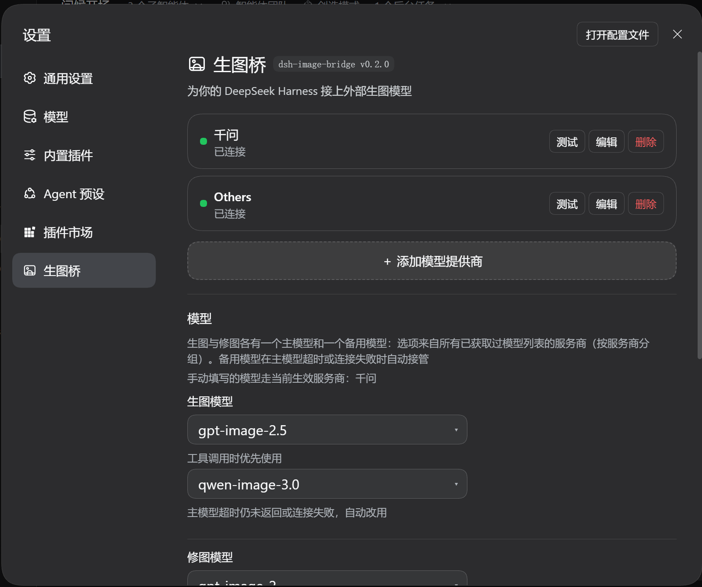

<p align="center">
  
</p>

# 生图桥 dsh-image-bridge

[English](README.en.md) | 中文

[](https://github.com/kkj-luna/dsh-image-bridge)
[](https://github.com/deepseek-ai)

给 [DeepSeek Harness](https://github.com/deepseek-ai) 里**没有作图能力的模型**接上外部生图服务。装一个插件，模型就多出 `image_generate`（生图）与 `image_edit`（改图）两个工具，图片作为持久附件出现在对话里，同时另存到会话工作区 `generated-images/`。



## 安装

装插件（一条命令，从 GitHub 装）：

```sh
dsh plugin --profile web add github:kkj-luna/dsh-image-bridge
```

重启 `dsh web`，打开 **设置 → 生图桥**。装的是仓库里的预构建产物，不用克隆、不用记本地路径。

> **npm 上还没有这个包。** `kkj-luna-dsh-image-bridge` 尚未发布到 npm（`registry.npmjs.org` 查不到），
> 所以 `dsh plugin --profile web add kkj-luna-dsh-image-bridge` 现在会失败——请用上面的 `github:` 写法。
> 发布之后这一节会改回 npm 一条命令。

前提是本机装着 `@deepseek-ai/dsh`（`dsh web` 跑得起来）。没有就先装：

```sh
npm i -g @deepseek-ai/dsh
```

**懒得敲命令？** 让 Agent 装：新建对话，把下面这句发过去，它会自己装、重启并核对结果。

```text
帮我安装这个插件：dsh plugin --profile web add github:kkj-luna/dsh-image-bridge
装完重启 dsh web，并确认「设置 → 生图桥」能打开、两个工具已注册。
```

**跟本地源码开发**（改代码时用）：

```sh
dsh plugin --profile web add <本仓库绝对路径>
```

### 装完怎么确认

重启 `dsh web` 后，三条任选（**重启是必须的**，插件代码不会被热重载）：

- 打开 **设置 → 生图桥**，能看到设置页；
- `$DSH_HOME/dsh-image-bridge-startup.json` 里 `steps` 有三步（`Config schema 就绪` / `两个工具已注册` / `测试通道已挂载`）、`services.tools` 为 `true`；
- 会话里模型能调用 `image_generate` 与 `image_edit` 两个工具。

### 卸载

```sh
dsh plugin --profile web remove kkj-luna-dsh-image-bridge
```

也可以在「设置 → 插件」里删。

| 你可能想知道 | 答案 |
| --- | --- |
| 包名为什么带 `kkj-luna-` | 为了在 npm 上唯一——`dsh-image-bridge` 已被别人占用。设置页徽标只显示仓库名 `dsh-image-bridge` |
| 为什么用 `github:` 装而不是 npm | 这个包**还没发布到 npm**，所以只能用 `github:`（或本地目录）。发布后 npm 一条命令即可 |
| 装完要不要重启 | **要**，插件代码不会被热重载 |
| 从旧版本升上来配置会丢吗 | 不会。行 id 与设置命名空间一直是 `image-bridge-v4`，包名换过两次但它只是个安装标识 |
| 想改代码怎么办 | 见[完整手册](docs/manual.md)的「开发本插件」——那是开发者路径，普通使用不需要 |

## 三步开始

1. **添加服务商**：设置 → 生图桥 →「＋ 添加模型提供商」，填接口地址（如 `https://api.openai.com/v1`）与 API Key。
2. **先测试、再保存**：点「测试连接」，模型列表出来后点浮层的**「保存」**。
3. **选模型并画图**：回到页面的「模型」区块，为生图、改图各选一个模型（可各配一个备用），点「保存模型设置」；然后直接对模型说「帮我画一只戴宇航头盔的柴犬」。

> **最容易踩的一步**：下拉候选来自**已经保存**的模型列表。只测试不保存就关掉浮层，模型不会进下拉——顺序是「测试连接 / 获取可用模型」→「保存」→ 下拉里才有。

## 你会得到

- **画图不靠模型本身**——当前模型有没有作图能力都不影响：它调用插件，插件去问外部生图服务，图片回传成对话里的图片附件
- **多家服务商并排**——每家各自的接口地址与 API Key，卡片上直接看连通状态；点一次「测试连接」顺带把这家的可用模型列出来
- **模型随便搭**——生图和改图可以选不同厂商的模型，各配一个主用 + 备用；主用失败自动换备用，并告诉你换成了哪个
- **只列能画图的模型**——你的 Key 可能带几百个模型，默认只显示判定为生图的那几个，想看全部点一下开关
- **尺寸可选**——八种常用预设，也可以自己填任意尺寸串
- **密钥不外泄**——API Key 存进 DSH 凭据服务（`$DSH_HOME/.credentials.yaml`，权限 `0600`），不写进配置文件，也不回传浏览器
- **升级不丢配置**——服务商、模型、尺寸存在 profile 里，更新插件不影响

## 支持的服务商

任何 **OpenAI 兼容**接口都行：OpenAI、智谱、通义千问、SiliconFlow，以及各类中转服务。生图打 `POST {接口地址}/images/generations`；改图打 `POST {接口地址}/images/edits`（multipart 上传参考图，参考图用会话工作区里的路径）。只要两样：接口地址与 API Key。

## 超时与换备用

生图接口是同步的，憋几十秒很正常（实测 42–61 秒）——所以**只在连不上时换备用，不因为画得慢换人**：

| 行为 | 值 |
| --- | --- |
| 连接超时（设置项，按秒填） | 默认 **15** 秒 |
| 备用的连接上限 | 固定 **30** 秒，不是设置项 |
| 整次调用上限 | `timeoutMs`，默认 **180000** 毫秒 |

- **连接超时只管「请求有没有发出去」**：DNS / TCP / TLS / 代理在 15 秒内没把请求发出去，就算这家连不上，改用备用模型。
- **请求一旦发出就不再计时**：服务商画多久都照等，由 `timeoutMs` 兜底。所以地址填错最多等 15 秒就换人，正常的慢生成不会被误判。
- **三种情况换备用**：连不上（连接超时或网络层直接失败）、非 2xx（含回包不是合法 JSON）、回包正常却解析不出任何可用图片。
- **两种不换**：你在界面上主动取消；图片已经产出、只是下载失败——已经计过费，不该再生成一次。
- **两家都连不上时**，错误以「**模型连接失败**」开头，并列出两次尝试各自的原因；想确认某家到底通不通，点设置页的「测试连接」。

> 老版本按「响应快慢」换备用，配置里那项叫 `fallbackAfterMs`（「主模型超时(毫秒)」，默认 90000）。**这项已整体删除**，老配置里的值会被当作未知字段丢掉，不影响运行。

## 常见问题

先看设置页的**状态灯**和卡片上的失败原因，多数问题那里就写着答案。

| 现象 | 原因 |
| --- | --- |
| 「没有可用的 API Key」 | 这张卡片没填、也没存过密钥。**不是**网络错误——请求根本没发出去 |
| 「密钥被拒绝（401/403）」 | 请求发出去了，服务商不认这把 Key |
| 「获取可用模型」报 404 | 这家不提供 `/models`，不影响生图 |
| 四个下拉是空的（禁用） | 还没保存过模型列表：测试连接 → **保存**。四处提示里说的「手动输入…」是**下拉里的一个条目**，而空状态下下拉本身是禁用的——先按上面两步把列表存上，才能选到它 |
| 设置里没有「生图桥」这一页 | 查插件是否启用、客户端日志里 `client apply` 是否 fatal；**改过代码要重启 DSH**（热重载默认忽略 `node_modules`） |

## 安全与隐私

- **密钥不落配置**：API Key 存 `$DSH_HOME/.credentials.yaml`（`0600`），配置文件里只有凭据名；密钥不回传浏览器，也不进日志。
- **没有显式密钥就不发请求**：请求里既没有显式密钥、也没有合法的凭据引用时，Host **一个字节都不发**，绝不拿别家服务商的密钥顶上；地址同样不回退。
- **对方给的图片地址要过 SSRF 关卡**：服务商可以回一个 URL 让客户端去下载——那个地址是**它给的**，所以只允许 `http`/`https`，并拒绝 `localhost` / `.local` / 环回与私网网段（`127.x`、`10.x`、`172.16-31.x`、`192.168.x`、`169.254.169.254`、`fe80:` / `fc` / `fd` 等）。
- **你自己填的接口地址允许本机**：本地生图服务是正当用法，只要协议是 http/https。
- **回包与下载都有上限**：回包正文 32 MiB，下载图片 15 秒 / 20 MiB，读取可被取消。
- **删除服务商不清理密钥**：删除只是配置操作。想清掉就自己删 `$DSH_HOME/.credentials.yaml` 里的那一行。

## 开发与验收

```sh
node .dib-verify/verify-manifest.mjs   # 47   清单与跨文件一致性
node .dib-verify/verify-client.mjs     # 180  客户端注册与组件渲染
node .dib-verify/verify-host.mjs       # 147  Host 端到端
node .dib-verify/verify-security.mjs   # 19   安全边界（SSRF 拒收、回包上限）
node .dib-verify/verify-resolve.mjs    # 8    依赖解析健壮性
node .dib-verify/verify-upgrade.mjs    # 24   升级后用户配置是否保留
```

共 **425 条断言**，无需联网、无需真实密钥。跨进程端到端另需先起一个本地模拟接口：

```sh
node .dib-verify/mock-image-api.mjs 8799   # 另开一个终端
node .dib-verify/verify-cross.mjs
```

脚本路径全部现场推导，没有写死机器路径；缺环境时会报错并告诉你要设哪个变量（`DSH_BIN` / `DSH_PROFILE_DIR` / `DIB_PLUGIN_DIR`）。

**为什么有 `verify-upgrade`**：用户的服务商配置**不在插件里**，而在 profile 的那一行上。插件自身的测试永远发现不了「改名 / 改行 id / 改默认值把用户已保存的配置弄丢」。这一套直接调用 Harness 真实导出的 patch 合成算法，按真实层序合成后断言配置零漂移。

## 目录

**仓库根目录就是插件包本身**（v0.3.0 起，这是一键安装的前提）：

```
package.json  cordis.patch.yml      插件清单与挂载声明
index.js      client.js             Host 半与客户端半
locale/       icon.svg              插件卡片文案与图标
README.md     docs/manual.md        本文件（仓库门面 / npm 页）与完整手册
.dib-verify/                        测试与验收套件（随仓库走，不进包）
generated-images/                   生图输出（已忽略，不入库）
```

`.npmignore` 把 `.dib-verify/`、截图与本地缓存挡在包外——插件装到用户机器上时只有跑起来需要的东西。

`dsh-image-bridge/`、`image-bridge/`、`plugins/dsh-image-bridge{,-live,-v3}/` 是历史副本，已被本包取代且不入库，请勿在此改动。

## 已知限制

- **改了插件代码要重启 DSH**：Node 缓存已加载模块，热重载忽略 `node_modules`（配置热更新是另一条通道，不受影响）
- **导航栏图标是权宜方案**：外壳按 section id 硬编码图标，第三方插件一律是齿轮。本插件挂载后「认领自己那一行」换成自己的标记；等官方 `settings.section` 支持 `icon` 后应改回官方能力
- **历史副本不入库**：`dsh-image-bridge/`、`image-bridge/`、`plugins/dsh-image-bridge{,-live,-v3}/` 只在本地保留

## 文档

| 文档 | 内容 |
| --- | --- |
| [插件完整手册](docs/manual.md) | 配置项、行为细节、排查、实现要点 |
| [变更记录](CHANGELOG.md) | 每个版本改了什么（当前 **v0.4.0**） |
| [验证报告](.dib-verify/verify-report.md) · [第二轮](.dib-verify/verify-report-2.md) | 独立验证结论（含未覆盖范围） |

## 反馈

提 [issue](https://github.com/kkj-luna/dsh-image-bridge/issues) 时附上三份自诊断文件的路径，排查会快很多：

| 文件 | 内容 |
| --- | --- |
| `$DSH_HOME/dsh-image-bridge-startup.json` | Host 每次激活覆写，含当前实际在用哪个服务商 |
| `$DSH_HOME/dsh-image-bridge-client.log` | 浏览器侧日志，**不含密钥** |
| `$DSH_HOME/dsh-image-bridge-degraded.json` | 只在依赖解析失败时出现 |

## 许可

[MIT](LICENSE)
